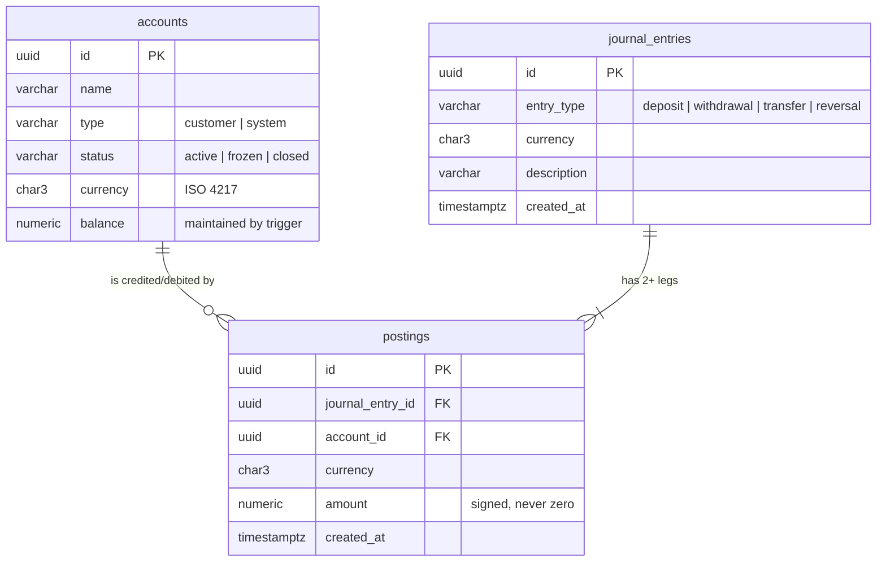

# FinLedger: Banking Ledger & Money Transfer API

[](https://github.com/vishant0815/finledger-banking-api/actions/workflows/ci.yml)


A production-style fintech backend: a **double-entry ledger** with **atomic, idempotent money
transfers** that stay correct under concurrent load.

The project is built in small, tested milestones. Its goal is to prove guarantees that matter
in real payment systems:

- Every posted journal entry balances to zero.
- 100 simultaneous transfers cannot overspend the same account.
- Retrying a transfer with the same idempotency key never charges the sender twice.
- Money is never represented as a float.

## Tech stack

| Area | Tools |
| --- | --- |
| API | Python 3.12+, FastAPI, Pydantic v2 |
| Database | PostgreSQL, SQLAlchemy 2.0 (async), asyncpg, Alembic |
| Messaging & cache | Apache Kafka *(Phase 9)*, Redis *(Phase 10)* |
| Auth | JWT (PyJWT), Argon2id password hashing, OAuth2 password flow |
| Quality | pytest, pytest-asyncio, httpx, Ruff, mypy (strict) |
| Delivery | Docker, Docker Compose, GitHub Actions |

## Roadmap

| # | Milestone | Status |
| --- | --- | --- |
| 1 | Project setup: FastAPI, config, logging, errors, Docker, CI | ✅ Done |
| 2 | Database design: accounts, journals, postings, migrations | ✅ Done |
| 3 | Authentication: JWT, registration, access control | ✅ Done |
| 4 | Account management | ⏳ Next |
| 5 | Double-entry ledger | |
| 6 | Money transfers: atomic, insufficient-funds checks | |
| 7 | Idempotency keys | |
| 8 | Concurrency control: row locking, race-condition tests | |
| 9 | Event-driven architecture: transactional outbox, Kafka | |
| 10 | Fraud detection rules & Redis rate limiting | |
| 11 | Integration, load, failure and security testing | |
| 12 | CI/CD, monitoring, documentation | |

## Quick start (Docker)

Requires Docker with the Compose plugin.

```bash
git clone https://github.com/vishant0815/finledger-banking-api.git
cd finledger-banking-api
cp .env.example .env          # then set POSTGRES_PASSWORD and JWT_SECRET_KEY
docker compose up --build      # starts PostgreSQL, applies migrations, then starts the API
```

| URL | What |
| --- | --- |
| http://localhost:8000/docs | Swagger UI |
| http://localhost:8000/api/v1/health | Liveness check |
| http://localhost:8000/api/v1/health/ready | Readiness check (includes PostgreSQL) |

## Local development

Requires [uv](https://docs.astral.sh/uv/) and a PostgreSQL instance. The easiest way to get
one is to start only the database container.

```bash
uv sync                                   # create .venv and install locked dependencies
cp .env.example .env                      # then set POSTGRES_PASSWORD and JWT_SECRET_KEY
docker compose up -d db                   # PostgreSQL on localhost:5432
uv run alembic upgrade head               # apply database migrations
uv run uvicorn app.main:create_app --factory --reload
```

### Quality checks

These run in CI on every push and pull request.

```bash
uv run ruff check .            # lint
uv run ruff format --check .   # formatting
uv run mypy                    # strict type checking
uv run pytest --cov            # unit + PostgreSQL integration tests
uv run pytest -m "not integration"   # unit tests only, no database needed
```

Integration tests create a throwaway `finledger_test` database, migrate it with Alembic and
run against the real schema. Locally they are skipped if PostgreSQL isn't running; in CI they
run against a PostgreSQL service container and can never be skipped. No Kafka or Redis needed.

### Migrations

```bash
uv run alembic revision --autogenerate -m "describe change"   # after changing models
uv run alembic upgrade head                                   # apply
uv run alembic downgrade -1                                   # roll back one step
```

A test fails if the models and migrations ever drift apart, and another runs a full
downgrade-then-upgrade round trip.

## Ledger data model



A **journal entry** is one financial event, for example "Alice pays Bob £30". Each **posting**
is one leg of it against one account. Amounts are signed (positive increases a balance), and
every entry's postings sum to zero, so money is only ever moved, never created. Deposits and
withdrawals balance against a `system` settlement account.

| Transfer £30 from Alice to Bob | account | amount |
| --- | --- | --- |
| posting 1 | Alice | −30.00 |
| posting 2 | Bob | +30.00 |
| **sum** | | **0.00** |

### Rules enforced by PostgreSQL itself

These hold even if application code has a bug. Each one has an integration test that bypasses
the application and tries to break it.

| Rule | How |
| --- | --- |
| Every entry balances (≥ 2 postings, sum = 0) | Deferred constraint triggers, checked at `COMMIT` |
| Ledger is append-only | Triggers reject `UPDATE`/`DELETE` on entries and postings; fix mistakes with a reversal |
| Balances can't drift from the ledger | Trigger applies each posting to `accounts.balance`; direct balance writes are rejected |
| Customer accounts can't go negative | `CHECK (type = 'system' OR balance >= 0)` on the running balance |
| No cross-currency postings | Composite foreign keys: posting currency = account currency = entry currency |
| Money is exact | `NUMERIC(19,4)` end-to-end with Python `Decimal`; floats are never used |
| Concurrent postings to one account serialise | The balance trigger's `UPDATE` takes a row lock; the CHECK sees the latest balance |

Violations surface as named constraints (`journal_entry_balanced`, `ledger_append_only`,
`balance_managed_by_ledger`, …), so the API layer can map them to precise error responses.

## API

All endpoints are versioned under `/api/v1`.

| Method | Path | Auth | Description |
| --- | --- | --- | --- |
| `GET` | `/api/v1/health` | none | Liveness: the process is up (no external calls) |
| `GET` | `/api/v1/health/ready` | none | Readiness: `200` if PostgreSQL responds, otherwise `503` |
| `POST` | `/api/v1/auth/register` | none | Create a customer account |
| `POST` | `/api/v1/auth/login` | none | OAuth2 password flow → JWT access token |
| `GET` | `/api/v1/users/me` | bearer | The logged-in user |
| `GET` | `/api/v1/users` | admin | List users (`limit`, `offset`) |

Example:

```json
GET /api/v1/health
{
  "status": "ok",
  "service": "FinLedger API",
  "version": "0.1.0",
  "environment": "local",
  "timestamp": "2026-11-23T16:45:00.000000Z"
}
```

Every error uses one envelope, and every response carries an `X-Request-ID` header:

```json
{
  "error": {
    "code": "not_found",
    "message": "Not Found",
    "request_id": "9f1c2b7e0d4a4e5f8a6b3c2d1e0f9a8b"
  }
}
```

## Authentication

```bash
# Register (passwords: 12–128 characters)
curl -X POST localhost:8000/api/v1/auth/register -H 'content-type: application/json' \
  -d '{"email": "alice@example.com", "password": "correct-horse-battery", "full_name": "Alice"}'

# Log in: OAuth2 form fields, so Swagger's "Authorize" button works too
curl -X POST localhost:8000/api/v1/auth/login \
  -d 'username=alice@example.com&password=correct-horse-battery'
# {"access_token": "eyJ...", "token_type": "bearer", "expires_in": 900}

curl localhost:8000/api/v1/users/me -H "Authorization: Bearer eyJ..."
```

Create the first admin (the password is prompted for, never passed as an argument):

```bash
uv run python -m app.cli create-admin --email admin@example.com --name "Ops Admin"
docker compose run --rm api python -m app.cli create-admin --email admin@example.com --name "Ops Admin"
```

Security decisions:

- **Argon2id** password hashing (RFC 9106 parameters), run in a worker thread so the slow
  hash never blocks the async event loop. Hashes are upgraded on login if parameters change.
- **Short-lived JWTs** (15 min) signed with HS256. The algorithm is pinned, so `alg: none`
  and algorithm-swap attacks fail. Issuer, audience, expiry and a unique `jti` are required.
- **No user enumeration:** a wrong password and an unknown email return the same 401, and
  take the same time (a dummy hash is verified when the email doesn't exist).
- **Live permissions:** the user is reloaded on every request, so deactivating an account or
  changing a role takes effect immediately, not when the token expires.
- **Race-safe sign-up:** a unique constraint on the (lowercased) email decides concurrent
  registrations; a test fires 5 at once and asserts exactly one account is created.
- Passwords are `SecretStr` end to end and never logged or echoed in validation errors.
- **Planned:** login rate limiting (Phase 10, Redis) and refresh tokens.

## Configuration

Settings are read from environment variables (or `.env`) via `pydantic-settings`.
See [`.env.example`](.env.example).

| Variable | Default | Notes |
| --- | --- | --- |
| `ENVIRONMENT` | `local` | `local`, `test`, `staging`, `production` (docs are disabled in production) |
| `LOG_LEVEL` | `INFO` | |
| `LOG_JSON` | `false` | JSON logs for staging/production |
| `POSTGRES_HOST` / `POSTGRES_PORT` | `localhost` / `5432` | |
| `POSTGRES_USER` / `POSTGRES_DB` | `finledger` | |
| `POSTGRES_PASSWORD` | *(required)* | No default. The app refuses to start without it. |
| `DB_POOL_SIZE` / `DB_MAX_OVERFLOW` | `5` / `10` | SQLAlchemy connection pool |
| `JWT_SECRET_KEY` | *(required)* | ≥ 32 characters. The app refuses to start without it. |
| `ACCESS_TOKEN_EXPIRE_MINUTES` | `15` | Access token lifetime |

## Project structure

```
app/
├── main.py                 # application factory + lifespan (DB engine setup/teardown)
├── cli.py                  # operational commands (create-admin)
├── api/
│   ├── deps.py             # dependencies: settings, DB session, current user, roles
│   └── v1/
│       ├── router.py       # /api/v1 router
│       └── endpoints/
│           ├── auth.py     # register, login
│           ├── users.py    # /users/me, admin user list
│           └── health.py   # liveness & readiness
├── core/
│   ├── config.py           # pydantic-settings configuration
│   ├── logging.py          # structlog setup (console locally, JSON in prod)
│   ├── middleware.py       # request IDs + structured access log
│   ├── security.py         # Argon2id hashing, JWT create/verify
│   └── exceptions.py       # domain errors + centralised handlers
├── db/
│   ├── base.py             # declarative base, naming conventions, money type
│   └── session.py          # async engine, session factory, DB ping
├── models/                 # SQLAlchemy models: User, Account, JournalEntry, Posting
├── repositories/           # data access (queries only, no business rules)
├── services/               # business logic (auth; ledger next)
└── schemas/                # Pydantic request/response models
migrations/                 # Alembic (async); versions/ holds schema + ledger triggers
tests/
├── api/                    # HTTP-level tests
├── unit/                   # config and DB helper tests
└── integration/            # real PostgreSQL: ledger rules, auth API, CLI, migrations
```

## Design notes

- **Application factory + lifespan.** The DB engine is created on startup and disposed on
  shutdown. Nothing connects at import time, and every test app gets an isolated instance.
- **Liveness vs readiness.** `/health` never touches dependencies, so an orchestrator won't
  restart a healthy process because the database blipped. `/health/ready` reports `503` so
  traffic is withheld instead.
- **Request tracing.** A pure ASGI middleware assigns or propagates `X-Request-ID`, binds it to
  every log line, and logs method, path, status and duration once per request. Client-supplied
  IDs are validated to prevent log injection.
- **Safe errors.** Unexpected exceptions are logged with a traceback but return a generic
  message. Validation errors never echo submitted values back to the client.
- **Secrets.** Credentials come only from the environment, `POSTGRES_PASSWORD` has no default,
  and the database URL is masked in logs.
